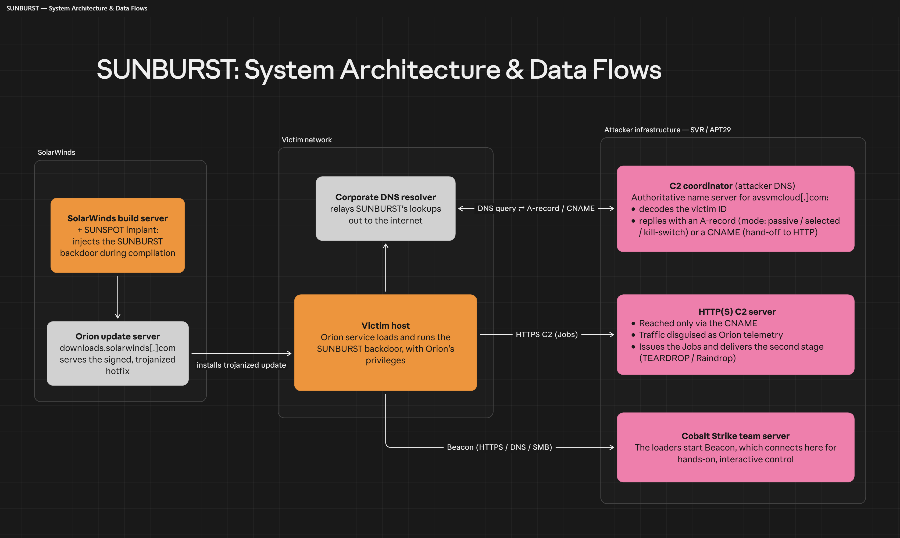

# APT29 / SUNBURST: Tactics, Techniques and Procedures

*Case study: the SolarWinds (Orion) supply-chain compromise, 2020*
Threat actor: **APT29** (also known as Cozy Bear, The Dukes, Nobelium, Midnight Blizzard), attributed
to Russia's Foreign Intelligence Service (SVR).

This document walks through how APT29 carried out the SolarWinds attack, step by step along the
**Cyber Kill Chain**. Each step gives *what happened*, *why it worked*, and the techniques used,
named and referenced to **MITRE ATT&CK**. A summary of the group's wider toolset, the vulnerabilities
and protocols it abuses, and the key indicators of compromise follow the walkthrough.

---

## 0. System Architecture

---

## 1. Overview

In 2020, APT29 conducted a **software supply-chain attack**. It compromised the software company
SolarWinds, hid a backdoor called **SUNBURST** inside a digitally signed update of the company's
**Orion** IT-monitoring product, and let SolarWinds distribute it to roughly **18,000 customers**
through the normal update channel.

SUNBURST stayed dormant for about two weeks, confirmed it was running on a genuine corporate network,
and then contacted the attackers over the **Domain Name System (DNS)**. This let the operators see
which organisation each infection belonged to and select **fewer than 100** of them for further
action, including nine U.S. federal agencies. On those chosen targets it opened an encrypted web
channel (HTTP/HTTPS) disguised as Orion's normal telemetry, installed **Cobalt Strike** (a commercial
intrusion-testing tool) for hands-on espionage, and finally moved into the victims' **Microsoft 365**
cloud using forged authentication tokens that bypassed multi-factor authentication.

---

## 2. The attack on the Cyber Kill Chain

```mermaid
flowchart TD
    P1["1. RECONNAISSANCE<br/>Breach SolarWinds, method unknown, Sept 2019<br/>Valid Accounts T1078 · Gather Victim Credentials T1589.001"]
    P2["2. WEAPONIZATION<br/>SUNSPOT swaps InventoryManager.cs in the build to inject SUNBURST<br/>Compromise Software Supply Chain T1195.002 · Stored Data Manipulation T1565.001"]
    P3["3. DELIVERY<br/>Trojanized, SolarWinds-signed Orion update to ~18,000 customers<br/>Compromise Software Supply Chain T1195.002 · Code Signing T1553.002"]
    P4["4. EXPLOITATION<br/>Orion's own service runs the backdoor; no software vulnerability<br/>Compromise Software Supply Chain T1195.002 · Obfuscated Files T1027"]
    P5["5. INSTALLATION<br/>SUNBURST persists and evades: two-week dormancy, Active Directory / lab-name / security-tool checks, disables defences<br/>Time-Based Evasion T1497.003 · System Checks T1497.001 · Security Software Discovery T1518.001"]
    P6["6. COMMAND AND CONTROL<br/>Stage 1 over DNS for victim triage; Stage 2 over HTTPS disguised as Orion telemetry; selected victims then receive the second stage<br/>Application Layer Protocol DNS T1071.004 · Domain Generation Algorithms T1568.002 · Web Protocols T1071.001 · Steganography T1001.002"]
    P7["7. ACTIONS ON OBJECTIVES<br/>Over the control channel, load Cobalt Strike; then forge authentication tokens and steal Microsoft 365 / Exchange email<br/>Ingress Tool Transfer T1105 · Forge SAML Tokens T1606.002 · DCSync T1003.006 · Remote Email Collection T1114.002"]

    P1 --> P2 --> P3 --> P4 --> P5 --> P6 --> P7

    classDef phase fill:#eef3fb,stroke:#2f5c9e,stroke-width:1px,color:#13233a;
    classDef actions fill:#fbeeee,stroke:#9e2f2f,stroke-width:1px,color:#3a1313;
    class P1,P2,P3,P4,P5,P6 phase;
    class P7 actions;
```

A higher-resolution version for slides is in [`diagrams/killchain.svg`](diagrams/killchain.svg); the
editable diagram source is [`diagrams/killchain.mmd`](diagrams/killchain.mmd).
The kill-chain phases are shown in their standard order. In the actual timeline the second-stage tool
(Cobalt Strike) is delivered through the command-and-control channel **after** the triage in phase 6,
and only to the selected victims, as the walkthrough below reflects.

---

## 3. Step by step along the kill chain

### Step 1: Initial access to SolarWinds · *Reconnaissance*
**What happened.** The attackers first compromised SolarWinds' own network. The method of entry was
never established; the earliest suspicious activity found internally dates to **September 2019**.
**Why it worked.** Compromising one trusted software vendor opens the door to all of its customers at once.
**Techniques.** Gather Victim Credentials (`T1589.001`), Valid Accounts (`T1078`).

### Step 2: Tampering with the build (SUNSPOT) · *Weaponization*
**What happened.** From February 2020 a tool named **SUNSPOT** ran on SolarWinds' build server. It
waited for the compiler to build Orion and, during the build, replaced one source file
(`InventoryManager.cs`) with a version containing SUNBURST, then restored the original so the code on
disk looked unchanged.
**Why it worked.** The malicious code was compiled by SolarWinds' own trusted process, so it inherited
the company's legitimacy. Nothing in source control was altered.
**Techniques.** Compromise Software Supply Chain (`T1195.002`), Stored Data Manipulation (`T1565.001`),
Process Discovery (`T1057`), Masquerading (`T1036.005`).

### Step 3: Distribution as a signed update · *Delivery*
**What happened.** The infected file (`SolarWinds.Orion.Core.BusinessLayer.dll`) was signed with
SolarWinds' genuine code-signing certificate and published as a routine update. Affected Orion
versions: 2019.4 HF5, 2020.2 (no hotfix), and 2020.2 HF1. Approximately 18,000 customers installed it.
**Why it worked.** A valid digital signature is how operating systems and security products decide a
file is trustworthy, so the backdoor passed every check. Customers were following normal security advice.
**Techniques.** Compromise Software Supply Chain (`T1195.002`), Subvert Trust Controls: Code Signing (`T1553.002`).

### Step 4: Execution at the victim · *Exploitation*
**What happened.** On installation, Orion's own service loaded the infected component, and a small
amount of added code started the backdoor, running with Orion's privileges, which, for a monitoring
product, are extensive.
**Why it worked.** **No software vulnerability was exploited.** The backdoor simply runs as part of
trusted software, so there is no malicious download, email, or exploit for defenders to detect.
**Techniques.** Compromise Software Supply Chain (`T1195.002`), Obfuscated Files or Information (`T1027`).

### Step 5: Persistence and evasion · *Installation*
**What happened.** Before taking any action, SUNBURST confirmed it was on a real target:
- It waited **12–14 days**, longer than an automated analysis sandbox observes a file.
- It checked the computer was joined to a corporate **Active Directory** domain, and stopped if the
  domain name resembled a SolarWinds test lab.
- It compared running programs, services, and drivers against hidden lists of **antivirus and
  endpoint-detection** products, pausing if one was present and disabling blocked security services.

**Why it worked.** Each check defeats a specific detection method: automated sandboxes, analyst
machines, and endpoint-security software.
**Techniques.** Time-Based Evasion (`T1497.003`), System Checks (`T1497.001`), Security Software
Discovery (`T1518.001`), Impair Defenses: Disable Tools (`T1562.001`).

### Step 6: Calling home and selecting victims · *Command and Control (stage 1)*
**What happened.** First contact used the **Domain Name System (DNS)**, which nearly every network
permits. SUNBURST generated subdomain names under **`avsvmcloud[.]com`** using a **domain generation
algorithm** (an algorithm that produces many unique domain names), encoding a machine identifier and
the victim's internal domain name. The attacker-operated name server answered each query. The **address
range** returned acted as an instruction:

| Address returned | Meaning |
|---|---|
| Private or reserved ranges (for example 10.0.0.0/8, 192.168.0.0/16) and a few specific ranges such as 20.140.0.0/15 | **Stop permanently** (kill switch) |
| Certain public ranges | Continue signalling over DNS |
| Other ranges | Return to a quiet, passive state |
| An alias record pointing to another domain | **Selected victim**: connect to that server (Step 7) |

**Why it worked.** DNS traffic is rarely blocked or inspected, and encoding the victim's identity
allowed roughly 18,000 infections to be narrowed to **fewer than 100** genuine targets.
**Techniques.** Application Layer Protocol: DNS (`T1071.004`), Domain Generation Algorithms (`T1568.002`),
Data Encoding (`T1132`).

### Step 7: Interactive control over the web channel · *Command and Control (stage 2)*
**What happened.** For a selected victim, SUNBURST connected to a real control server and communicated
over **HTTPS**, shaped to look like Orion's own "Improvement Program" telemetry: outgoing data packed
into telemetry-like messages. The replies resembled harmless program data, but the commands were
**concealed inside that normal-looking content** (hidden in values shaped like identifiers and hex,
which the backdoor extracted and decoded). This is **steganography**: hiding information inside other
data so its presence is not obvious. The same idea appears in the second stage, where a payload
is hidden inside a file disguised as an image (`gracious_truth.jpg`, Step 8). Server names matched
names inside the victim's network and were often hosted in the victim's own country. SUNBURST
understood a small set of commands (profile the system, read and write files and registry values, run
a program, reboot).
**Why it worked.** Blending with Orion's expected traffic made the control channel very difficult to
distinguish from legitimate activity.
**Techniques.** Application Layer Protocol: Web Protocols (`T1071.001`), Data Obfuscation: Protocol
Impersonation (`T1001.003`), Steganography (`T1001.002`), Hide Infrastructure (`T1665`).

### Step 8: Second-stage tooling: Cobalt Strike · *Installation (after triage)*
**What happened.** On selected victims, and **through the control channel established above**, SUNBURST
delivered a loader to launch **Cobalt Strike**:
- **TEARDROP**: runs only in memory as a service and reads its payload from a file disguised as an
  image (`gracious_truth.jpg`); delivered directly by SUNBURST.
- **Raindrop**: the same role, built from modified 7-Zip code, and seen on *other* machines within a
  victim's network as the attackers moved laterally.

Both loaders exist to start **Cobalt Strike**, a *commercial* intrusion-testing framework (its agent
is called Beacon) that attackers widely pirate and abuse. Cobalt Strike, not the loaders, is the tool
that gave the operators hands-on, interactive control. The connection between SUNBURST and Cobalt
Strike was deliberately broken so that discovering one did not reveal the other.
**Why it worked.** A widely used commercial tool blends in with legitimate security testing, and the
broken link frustrated investigation.
**Techniques.** Ingress Tool Transfer (`T1105`), Image File Execution Options Injection (`T1546.012`),
Create or Modify System Process: Windows Service (`T1543.003`), Obfuscated Files: Steganography
(`T1027.003`), Indicator Removal: Clear Persistence (`T1070.009`).

### Step 9: Lateral movement and credential theft · *Actions on Objectives*
**What happened.** Human operators took over. They mapped Active Directory with the **AdFind** utility
(renamed to blend in), stole credentials (Kerberoasting; **DCSync**, which copies password data from a
domain controller), and moved between machines using Remote Desktop Protocol, Windows Management
Instrumentation, and PowerShell remoting. Each step used a **different stolen account**, so no single
account produced a suspicious trail. They disabled logging and firewall rules while working
and altered file timestamps.
**Why it worked.** Using valid administrator credentials and built-in tools makes the activity
resemble normal administration.
**Techniques.** Account Discovery (`T1087.002`), Kerberoasting (`T1558.003`), DCSync (`T1003.006`),
Remote Services: Remote Desktop Protocol / Windows Management Instrumentation (`T1021.001`, `T1047`),
Indicator Removal (`T1070`).

### Step 10: Moving into the cloud and stealing email · *Actions on Objectives*
**What happened.** The objective was email, much of it in **Microsoft 365**. With domain-level
privileges, the attackers stole the certificate that an organisation's federation server uses to sign
login tokens, and forged login tokens to authenticate as **any** user, bypassing multi-factor
authentication, because the cloud service assumes it was already satisfied. This technique is known as
**Golden SAML** (SAML, Security Assertion Markup Language, is the standard behind single sign-on). They
also added their own trusted login provider and credentials to cloud applications that could read mail,
then collected target mailboxes through Microsoft's own interfaces; on on-premises Exchange servers
they exported mailboxes, compressed them, and downloaded them disguised as an image file.
**Why it worked.** Forged tokens and legitimate cloud applications require no malware and leave little
trace on the victims' own computers.
**Techniques.** Unsecured Credentials: Private Keys (`T1552.004`), Forge Web Credentials: SAML Tokens
(`T1606.002`), Domain or Tenant Policy Modification: Trust Modification (`T1484.002`), Additional Cloud
Credentials (`T1098.001`), Remote Email Collection (`T1114.002`).

### Step 11: Discovery and containment · *Context*
The campaign was made public in December 2020. Defenders seized the `avsvmcloud[.]com` domain and
pointed it to an address inside SUNBURST's kill-switch range, so any remaining copies shut themselves
down. The kill switch stopped SUNBURST only; Cobalt Strike, stolen accounts, and forged cloud logins
had to be removed separately. In April 2021 the United States and United Kingdom formally attributed
the operation to the SVR (APT29).

---

## 4. Recurring techniques across APT29 campaigns

These are the methods APT29 reuses across operations. They are the basis on which new campaigns are
attributed to it.

| Technique | How it appears | MITRE ATT&CK |
|---|---|---|
| Supply-chain and trusted-channel compromise | SUNBURST (Orion); JetBrains TeamCity exploitation, 2023 | Compromise Software Supply Chain (`T1195.002`); Exploit Public-Facing Application (`T1190`) |
| Spearphishing, in evolving formats | Malicious documents, then smuggled disk images, then signed remote-desktop files (2024) | Phishing (`T1566.001`/`.002`); User Execution (`T1204`) |
| Legitimate web and cloud services for control | Twitter, GitHub, OneDrive, Dropbox, Notion, Trello, over many years | Web Service (`T1102`); Exfiltration to Cloud Storage (`T1567.002`) |
| Hiding data inside images (steganography) | HAMMERTOSS, RegDuke, GraphicalProton, FoggyWeb | Steganography (`T1001.002`, `T1027.003`) |
| Identity and authentication-token abuse | Golden SAML; federation-server backdoors (FoggyWeb, MagicWeb); cloud-application abuse | Forge Web Credentials: SAML (`T1606.002`); Modify Authentication Process (`T1556.007`) |
| Side-loading loaders + commercial tooling | Signed programs side-load loaders that launch Cobalt Strike, Brute Ratel, or Sliver | DLL Side-Loading (`T1574.001`); Rundll32 (`T1218.011`) |
| Anonymising infrastructure | Tor with domain fronting; compromised websites and devices; residential proxies | Multi-hop / Domain Fronting (`T1090.003`/`.004`); Hide Infrastructure (`T1665`) |

---

## 5. Malware and tools used in this attack

| Name | Role | Nature |
|---|---|---|
| SUNSPOT | Build-server implant that inserted SUNBURST | Custom malware |
| SUNBURST | First-stage backdoor hidden in Orion | Custom malware |
| TEARDROP / Raindrop | In-memory loaders for the second stage | Custom malware |
| Cobalt Strike (Beacon) | Interactive command-and-control for hands-on operations | Commercial tool, abused |

A fuller catalogue of APT29's malware across campaigns is provided in the accompanying material.

---

## 6. Exploited vulnerabilities

The SolarWinds attack used **no vulnerability**. It was a supply-chain implant. Across other
campaigns, however, APT29 exploits known vulnerabilities for initial access. The most frequently cited
set, from the April 2021 United States / United Kingdom joint advisory, is:

| Identifier | Product | Type | Severity (CVSS) |
|---|---|---|---|
| CVE-2019-19781 | Citrix Application Delivery Controller / Gateway | Directory traversal leading to remote code execution | 9.8 |
| CVE-2019-11510 | Pulse Secure virtual private network | Arbitrary file read | 10.0 |
| CVE-2018-13379 | Fortinet FortiOS virtual private network | Path traversal | 9.8 |
| CVE-2019-9670 | Zimbra Collaboration Suite | XML external entity injection | 9.8 |
| CVE-2020-4006 | VMware Workspace ONE Access | Command injection | 9.1 |
| CVE-2023-42793 | JetBrains TeamCity | Authentication bypass leading to remote code execution | 9.8 |

---

## 7. Network protocols abused

- **Domain Name System (DNS):** subdomains generated by an algorithm, with the returned address range
  signalling the malware's behaviour, and an alias record handing off to the web channel.
- **HTTPS (web traffic):** control traffic disguised as Orion telemetry, with commands concealed
  inside otherwise normal-looking responses.
- **Security Assertion Markup Language (SAML):** forged single-sign-on tokens signed with a stolen
  certificate.
- **OAuth 2.0 authorisation:** abuse of cloud applications and their access tokens.
- **Remote Desktop Protocol, Server Message Block, Windows Management Instrumentation, PowerShell
  remoting:** used for movement between machines inside a network.

---

## 8. Key indicators of compromise

- **Affected Orion versions:** 2019.4 HF5, 2020.2 (no hotfix), and 2020.2 HF1. The trojanized file was
  `SolarWinds.Orion.Core.BusinessLayer.dll`.
- **SUNBURST file hash (SHA-256):** `32519b85c0b422e4656de6e6c41878e95fd95026267daab4215ee59c107d6c77`
- **SUNSPOT file (`taskhostsvc.exe`, SHA-256):** `c45c9bda8db1d470f1fd0dcc346dc449839eb5ce9a948c70369230af0b3ef168`
- **Primary control domain:** `avsvmcloud[.]com`
- **Selected follow-on control domains:** `freescanonline[.]com`, `deftsecurity[.]com`, `thedoccloud[.]com`
- **Second-stage artifact:** the file `gracious_truth.jpg` used by TEARDROP.

*(Domain names are written with `[.]` so they cannot be clicked by accident.)*

---

## 9. Sources

Primary references: Mandiant, *SUNBURST Additional Technical Details*; MITRE ATT&CK, Group G0016 (APT29)
and Campaign C0024 (SolarWinds Compromise); CISA Alert AA20-352A; CrowdStrike, *SUNSPOT: An Implant in
the Build Process*; and the NSA / CISA / FBI advisory *Russian SVR Targets U.S. and Allied Networks*
(April 2021). The full, annotated source list is in [`sources.md`](sources.md).
