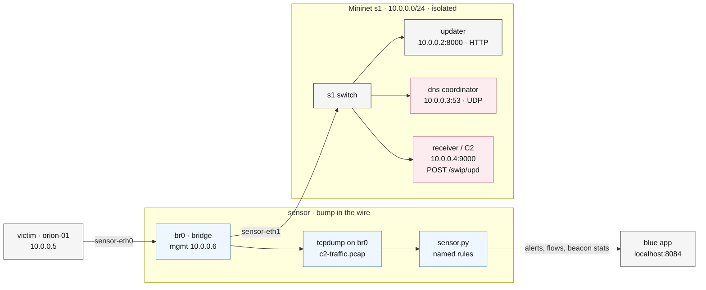
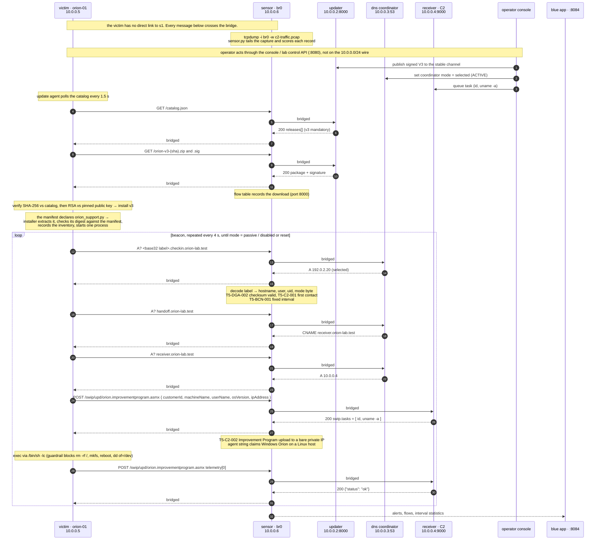

# Task 5 PoC Playbook

This walkthrough follows a signed software release from a supplier pipeline to a managed client, then shows the client's DNS check-in and operator tasking. It is a simulation; the only executable code in a package is the small Python component that the signed V3 build carries.

Presenters: the timed run of show, the speaking lines, and the failure recoveries are in [demo-runbook.md](./demo-runbook.md). This file explains what the lab does and why.

## What the demo shows

| Beat | Open | What appears | Claim it supports |
| --- | --- | --- | --- |
| Build | Build & Release | The release pipeline runs checkout, build, manifest, package, sign, and publish; a build step changes one file, and the manifest is generated afterwards and pins it. | A signed release can contain code the source never had. |
| Delivery | Build & Release, then Orion Network Manager | A V3 package signed with the supplier key reaches the client through the normal channel; the client checks the catalog digest, the RSA signature, and the component digest, then installs. | A signed update can carry malicious code without breaking the normal trust path. |
| Introduction of the implant | Orion Network Manager history and installed components | The installer registers `orion-improvement-program` from the signed package and starts one process. V1 and V2 start nothing. | The backdoor arrives with the build, not with the platform. |
| Dormant check-in | Operator Console, Encoded check-ins | Labels built from the host name and user; mode byte 4, then 5 once the coordinator returns the activation address. | The victim identifier is encoded, and the coordinator decides what happens next. |
| Command and control | Operator Console, DNS and HTTP activity | One POST per interval to an Improvement Program path on a bare private address, with an `Orion/` agent string. | C2 shaped as vendor telemetry over a channel that never resolves publicly. |
| Tasking | Operator Console, Remote tasking and Command results | A command is queued, delivered in `swip.tasks`, executed, and the output returns in a `telemetry` block. | Actions on objectives, with a real command and a real exit code. |
| Detection | Blue Team app | Decode of the label with checksum, interval statistics, first contact, and the telemetry upload, each from captured packets. | The traffic is detectable from the wire without reading the implant's logs. |
| Response | Blue Team app, then Operator Console | Resolver block or tap isolation, and the console stops receiving check-ins within one interval. | Containment is enforced at the network, not in the UI. |

The pieces behind each beat:

| Path | Role |
| --- | --- |
| `lab/dga.py` | Wire format, encoder and decoder for the check-in label, and the parity check against the implant's own encoder. |
| `pipeline/src/` | The approved source tree: a clean service-health component and the release definition the build starts from. |
| `pipeline/build/build_release.py` | Copies the source into a workspace, runs the `service-compat` step, generates the manifest from the workspace, and packages. |
| `pipeline/payload/orion_support.py` | The component the build step injects: identity, label, DNS, Improvement Program upload, tasking, guardrail. |
| `pipeline/backend/release_builder.py` | Validates and signs the package, and refuses files the manifest does not declare. |
| `lab/scenario.py` | Update agent, install, component registration, and the operator console state. |
| `lab/services.py` | Updater, DNS coordinator, and the HTTP receiver that answers in OIP shape. |
| `lab/topology.py` | Mininet topology, the sensor bridge, and the capture. |
| `lab/sensor.py` | Rules that read the capture file and produce alerts, decoded rows, flows, and interval statistics. |
| `blue/` | The defender app: raw tables, expandable events, and the two response actions. |

## Topology

The victim's only link to the switch runs through the sensor, which bridges the two sides. The sensor is therefore in the path of every packet, not a reader of application logs.

The bridge has no address on the victim side and one management address (`10.0.0.6`) so the tap can be identified in the lab. The victim keeps its address and default behaviour; the switch still learns its MAC through the bridge.

## Sequence Diagram

## Applications

| Application | Address | Role |
| --- | --- | --- |
| **Build & Release** | `http://localhost:8080` | Run the release pipeline (checkout, build, manifest, package, sign, publish) and inspect its stages; shows the catalog and pipeline output. |
| **Orion Network Manager** | `http://localhost:8081` | Client update agent, version, and normal update history. |
| **Operator Console** | `http://localhost:8082` | Beacons, typed commands, and the C2 capture. |
| **Presentation Dashboard** | `http://localhost:8083` | Reset button, the seven-phase attack-story ribbon, and running services. |
| **Blue Team** | `http://localhost:8084` | Inline sensor findings, decoded queries, beacon statistics, flows, and the two enforced response actions. |

Open each address in its own tab; the apps do not link to each other. Nginx routes ports 8080 to 8084.

## How it works

The lab runs a Mininet network in a Linux container behind a private control API. Addresses live in `lab/config.py`. The victim reaches the switch only through a sensor host that bridges the two links, so the sensor carries the updater download, the DNS check-ins, and the HTTP C2. The supplier writes releases to a shared volume, and the updater serves them to the virtual client. The client polls the stable channel every 1.5 seconds, downloads the ZIP and signature over HTTP inside the isolated network, checks the package SHA-256 against the catalog, and verifies an RSA/SHA-256 signature with a pre-provisioned public key.

V1 and V2 packages carry only `manifest.json`. The client installs them as data and starts nothing. A V3 manifest may also declare components. Each entry names a file in the same ZIP, pins its SHA-256, and gives the arguments for the service. The installer extracts the package into a work directory, checks every declared digest, records the component inventory, and starts one process per declared component. No other file is executed, and a component the manifest does not declare is never started. This is the build compromise in miniature: the supplier signature covers `orion_support.py` because the supplier's build put it in the package, in the same way the signed Orion update carried the trojanized DLL that SUNBURST lived in.

The build path makes that compromise explicit. `pipeline/src/` holds the approved source; `pipeline/build/build_release.py` copies it into a workspace, runs the `service-compat` step, hashes the workspace, generates the manifest from those hashes, and packages. The step replaces `orion_support.py` with the file in `pipeline/payload/`. Because the manifest is generated after the step, the component digest, the package digest, and the signature all agree with the tampered artifact. The release app exposes one action: **Run release pipeline**. It runs the build, signing, and publishing jobs in order and reports each stage, so the presenter does not sign or publish by hand.

The DNS and HTTP stage follows Mandiant's description of SUNBURST. Each check-in is a UDP A question whose leftmost label is the encoded record. The coordinator decodes the label and rejects a malformed record or a failed checksum with NXDOMAIN. Otherwise it answers by the coordinator mode file: passive returns `192.0.2.10`, active returns `192.0.2.20`, disabled returns NXDOMAIN. The implant starts at mode byte 4, changes to 5 after the activation address, and sends one final check-in at 3 after the kill switch. An active check-in also resolves the fixed CNAME `handoff.orion-lab.test` and then `receiver.orion-lab.test`, so the HTTP address stays out of the packaged component. [Mandiant SUNBURST](https://cloud.google.com/blog/topics/threat-intelligence/evasive-attacker-leverages-solarwinds-supply-chain-compromises-with-sunburst-backdoor) [SolarWinds update](https://www.sec.gov/Archives/edgar/data/1739942/000173994221000076/swi-20210507.htm)

The check-in name is decodable by design. The record holds a version byte, the mode byte, a four-byte victim uid, length-prefixed hostname and username, and a CRC-16 checksum. The implant XORs the record with a fixed keystream derived from one constant string and base32-encodes it without padding, all in `pipeline/payload/orion_support.py`. A fixed key and a standard encoding mean a capture can be decoded offline, the same property that made SUNBURST's own check-in names recoverable. `lab/dga.py` documents the field layout. Its `python3 lab/dga.py` mode compares the coordinator's encoder with the implant's copy on 200 random identities and exits non-zero on any difference.

The HTTP stage is shaped like the update agent's own telemetry. Every upload goes to one endpoint, `/swip/upd/orion.improvementprogram.asmx`, with the vendor's `Orion/2020.2.4` user agent and a body of Improvement Program fields: `customerId`, `machineName`, `userName`, `osVersion`, `ipAddress`, `processId`. Tasking comes back inside the same envelope under `swip.tasks`, and a finished task is another upload whose `telemetry` block carries the exit code and output. Nothing in the request names a command or a check-in. That is the point: on the wire it reads as routine telemetry, and the giveaways are that the destination is a bare private address and that the agent string claims a Windows Orion client while the host runs Linux.

The private key is read-only in the supplier container; the trust volume holds only the public key.

## Inline sensor and tap

The sensor is a Mininet host with two interfaces and a Linux bridge between them: `sensor-eth0` faces the switch, `sensor-eth1` faces the victim. The bridge carries the management address `10.0.0.6` from `lab/config.py`. The victim keeps `10.0.0.5` and its default behaviour; the switch learns its MAC through the bridge, so nothing else in the lab changes.

`topology.py` starts two processes in the sensor's network namespace. `tcpdump -U -n -i br0 -w /tmp/task05-poc/capture/c2-traffic.pcap` filters `udp port 53 or tcp port 9000 or tcp port 8000`. The capture runs without `-p`, so tcpdump puts `br0` in promiscuous mode and the bridge hands it a copy of every forwarded frame, not only the ones addressed to the bridge itself. `sensor.py` tails that capture file, parses each record, and writes a snapshot of its findings to `/tmp/task05-poc/sensor/state.json`, which the lab API serves to the Blue Team app. Both processes restart on reset and stop when the lab container stops. The pcap download in the operator console is the same file the detector reads, so the expanded event and Wireshark show the same bytes.

The tap therefore sees everything the victim sends and receives. It does not read `dns.log`, `receiver.log`, or the beacon list, and it does not know the scenario phase.

That includes the V3 download on port 8000. The flow table keeps it because delivery and check-in belong side by side in a defender's view, and a byte count next to the check-in traffic answers the question about how the implant arrived. No rule alerts on the download itself: it is the legitimate update channel, the transfer is signed and well formed, and the only malicious part is the declared component that the signed manifest introduces.

### Why a Python detector and not Suricata

Suricata 7.0.3 installs from the Ubuntu 24.04 archive, and its build information lists PCAP and AF_PACKET support. It was not run on the bridge: the rule-language problem decided the choice. Three of the seven rules need state the Suricata rule language does not carry: a base32 decode with a CRC-16 check, interval statistics over successive queries, and reuse of one decoded label across sources. Those would be Lua scripts next to a YAML config, and the checksum rule would duplicate a decoder the lab already ships in `lab/dga.py`, which is also the contract with the implant. One Python process over the same pcap keeps every rule auditable and keeps the alert and its packet excerpt in one place. The tradeoff is that the lab gets no community rule feed and no protocol parsers beyond the ones it needs. Suricata would be the better base for a production sensor that also wants TLS metadata, file extraction, and a maintained ruleset.

### Rules

All seven rules are computed from captured packets. An empty capture produces no alerts.

| Rule | Computed from | Why it matters |
| --- | --- | --- |
| `T5-DGA-001` | Leftmost label is 32 to 63 characters of the base32 alphabet under the check-in suffix. | The client emits machine-built labels, not normal browsing names. |
| `T5-DGA-002` | The label decodes, the CRC-16 matches, and the recorded uid matches the encoded identity. | This is the implant's own encoder. A checksum-valid record is not a lookalike. |
| `T5-DGA-003` | The label has the encoded shape but fails base32, version, length, or checksum checks. | Something tried to speak the encoding and got it wrong. |
| `T5-DGA-004` | The same decoded label appears from a second source address. | One host's identity was replayed from another address. |
| `T5-BCN-001` | Intervals between check-in queries from one source: mean, spread, and coefficient of variation over at least three intervals. | The queries are a scheduled beacon, not user or browser timing. |
| `T5-C2-001` | First packet in this capture from a source to a new destination address and port. | This host opened a conversation with an address nobody had used before. |
| `T5-C2-002` | HTTP POST to an IP literal in a non-global range on an Improvement Program shaped path such as `/swip/upd/`, or carrying an `Orion/` user agent. | The endpoint never resolves to a public vendor host, yet the client posts updater-shaped data there. |

The beacon rule fires when the spread is at most 12 percent of the mean (or 0.3 seconds, whichever is larger) over three or more intervals with a mean of at least half a second. The lab beacons every 4 seconds, so it fires on the fourth query.

Mandiant describes the pieces these rules look for. The DGA subdomains carry an encoded user ID and, in passive mode, the victim domain, which the coordinator can recover and likely uses to route the host. [Mandiant, "SUNBURST Additional Technical Details", 24 December 2020, section "Domain Generation Algorithm"](https://cloud.google.com/blog/topics/threat-intelligence/sunburst-additional-technical-details) The HTTP body imitates Orion Improvement Program messages, which is why a POST to a telemetry-shaped path from an updater host is worth alerting on. [Same report, section "HTTP(S) C2"](https://cloud.google.com/blog/topics/threat-intelligence/sunburst-additional-technical-details)

Two limits matter for the demo. Mandiant says the real implant reached its C2 through the hostname from a CNAME record and could not use a raw IP. The lab component posts to the address it resolved, so this lab shows the stronger bare-IP variant; that difference is in the packaged component, not in the detection claim. Also, decoding a label proves the encoder ran on that host. It does not prove follow-on activity, which is the same caution Mandiant gives about decoded victim domains. [Same report, Q&A](https://cloud.google.com/blog/topics/threat-intelligence/sunburst-additional-technical-details)

## Start and control

Start Docker Desktop on macOS, open `tasks/task05-poc`, and run `docker compose up --build`. On Linux, use Docker Engine with the Compose plugin and the same command.

If a port is taken, set `PIPELINE_PORT=8180 CLIENT_PORT=8181 ATTACKER_PORT=8182 DASHBOARD_PORT=8183 BLUE_PORT=8184` before starting. Run `docker compose down` before rebuilding or to stop.

The Presentation Dashboard has only **Reset lab**. Reset the lab there, and use the client and pipeline apps for update checks, installs, and publishing. Reset rewinds the release channel to V1/V2 first, then the client, the coordinator, the capture, and the sensor. Both halves run even when one of them fails, and the message names the half that did not reset. That is the only way to prepare a second V3 publish.

## Walkthrough

1. **Reset.** Click **Reset lab** in the Presentation Dashboard. This resets the channel to V1/V2, installs V2, stops any running component and clears its files, sets the coordinator to PASSIVE, clears beacons, tasks, and the capture, and restarts the capture and the sensor.
2. **Set the response mode.** In Operator Console choose **ACTIVE** and click **APPLY**. No beacons exist yet.
3. **Run the pipeline.** In Build & Release choose **Stable · mandatory** and click **Run release pipeline**. The stage list fills in order: source checkout, build component, generate manifest, package artifact, sign artifact, publish catalog. The build step changes `orion_support.py`, and the manifest is generated afterwards and pins the changed digest. Signing and publishing are pipeline jobs, not separate buttons. V3 cannot be republished; reset before running the pipeline again.
4. **Watch delivery.** On the next poll the client downloads the catalog, ZIP, and signature, checks the digest and RSA signature, extracts the package, verifies the component digest, and installs V3. Update history shows normal events only: found, downloaded, verified, installed, and one line naming the registered component.
5. **Watch the beacon.** Three seconds after install the component reads the host name and user, builds the label, and queries `<label>.checkin.orion-lab.test`. In ACTIVE mode the coordinator returns the activation address; the component follows the CNAME handoff and posts its details as an Improvement Program upload. The console lists `orion-01`, user, OS, address, process, PID, and architecture, plus an `Encoded check-ins` table with the decoded host, user, uid, and mode byte. Click any row for the field breakdown. The same label appears in the DNS log and in the pcap. The component repeats the loop every four seconds until the coordinator returns NXDOMAIN or reset stops the process.
6. **Send a command.** Choose **All beacons** or `orion-01` under **Target**, type `id` or `id; uname -a`, and click **SEND COMMAND**. On the next upload the receiver returns the task in `swip.tasks`, the component runs it with `/bin/sh -lc`, and the output and exit code return in a `telemetry` block and appear under **Command results**. A task queued in PASSIVE waits for an ACTIVE check-in.
7. **Compare modes.** PASSIVE returns the passive address with no HTTP follow-on, so new beacons and tasks do not proceed, and the implant drops back to mode 4. DISABLED returns NXDOMAIN; the implant sends one final check-in at mode 3 and exits, so no further queries appear. To run the beacon again, reset the lab and publish V3 again. Reset returns the coordinator to PASSIVE.
8. **Defender view.** Keep the Blue Team tab open through steps 1 to 6. Rows appear while the beacon runs; the walkthrough order is in the next section.
9. **Respond.** From the Blue Team app, block the check-in suffix or isolate the victim at the tap, and watch the operator console go quiet. Both actions are reversible, and reset restores both.
10. **Review and reset.** Use either pcap link, from the operator console or an expanded event. The capture now holds the updater download on port 8000 as well as DNS and receiver traffic. Reset again to clear alerts, flows, and both response actions.

## Defender view

Open `http://localhost:8084` before the first beacon. The header carries the tap state, the packet count, the last packet time, the pcap link, and the two response controls. The events table may already hold one first-contact row for the updater, and the decoded and interval tables fill as traffic appears. The app reports only what the tap carried.

The filter box narrows every table as you type, matching across the visible fields, and the range selector limits rows to the last minute, five minutes, fifteen, or an hour. Counts read visible over total.

Walk through it in this order. Events are newest first, so the story reads from the bottom row upward:

1. **Response controls.** Both read `forwarding` and `open (selected)`. Leave them until the events table has content.
2. **First contact with the updater.** `T5-C2-001` from `10.0.0.5` to `10.0.0.2:8000`, when the update agent starts polling. The rule fires on an ordinary conversation too, which is what a first-contact rule does.
3. **First contact with the coordinator.** `T5-C2-001` from `10.0.0.5` to `10.0.0.3:53`, within a second of the V3 install. Expand it for the packet excerpt.
4. **Interval statistics.** After four queries the table shows the sample count, a mean near 4 seconds and a spread of a few hundredths. The matching `T5-BCN-001` row carries the numbers from the moment it fired.
5. **Telemetry upload.** `T5-C2-002` for a `POST` to `/swip/upd/orion.improvementprogram.asmx` on `10.0.0.4:9000`, with `User-Agent: Orion/2020.2.4 (Windows NT 10.0; Win64; x64)`. The expanded row holds the request line, the agent string, and the resolver that supplied the address.
6. **Decoded check-ins.** Every label appears with host name, user, uid, mode and checksum. A lookalike that fails the checksum appears as `T5-DGA-003` instead.
7. **Flows.** Three conversations: the updater download, the DNS check-ins, and the telemetry upload. The download row stays in the table on purpose; the tap that watches the check-in also carried the package.
8. **Expanded event.** Every row opens the same way: the rule, the flow, the timestamp, the matching fields, the packet excerpt in hex, and a link to the pcap. Expand one on stage and leave the rest collapsed.

If the events table stays empty after the V3 install, check the tap status. A stopped capture or an old last-packet time means the sensor is not reading; the error appears next to the tap state.

### Response actions

Both controls change lab state. Neither is a UI effect.

**Block suffix** writes the coordinator's disabled mode, which the DNS service already owns. The coordinator answers NXDOMAIN for real check-in labels, the component's next check-in reports `disabled`, and the component process exits. The operator console's mode selector shows `DISABLED`, the timeline stops growing, and no new row appears. **Clear block** restores the coordinator to the mode that was active before the block, so a fresh V3 install checks in normally. The running component has already exited on the NXDOMAIN, so beacons do not resume until reset and another publish. One NXDOMAIN ends the component's loop.

**Isolate victim** installs a `tc` egress filter on the sensor's switch-side port (`sensor-eth0` in this build). Every frame the bridge would send toward the switch is dropped. The filter runs after the bridge has copied the frame to the capture point, so the pcap keeps showing the victim's DNS queries while no answer comes back, and the operator console goes quiet within one beacon interval. The interval table then shows the spacing change while the numbers from the fired row stay as they were. The app reports the mechanism it used. If `tc` is unavailable in the container, the sensor falls back to setting the uplink port down and says so; forwarding is restored by the same control.

**Reset** in the Presentation Dashboard lifts isolation first, so the V2 reinstall during reset can reach the updater, then resets the lab. The restarted tap begins with forwarding restored and an empty sensor state.

Do not click **APPLY** in the operator console while a resolver block is on. The lab refuses the change and says why, so the block cannot be undone by accident; clear it in the Blue Team app or reset the lab. In the demo, the block is the defender's move and the attacker does not get a turn afterwards.

## Kill-chain mapping

| Phase | Lab event |
| --- | --- |
| Weaponization | Build the tampered V3 artifact; the build step swaps one source file. |
| Delivery | Publish the signed V3 package to stable. |
| Exploitation | Client installs the signed package. |
| Installation | The installer registers the declared component and starts it. |
| Command and Control | DNS check-in, CNAME handoff, HTTP beacon registration. |
| Actions on Objectives | Operator sends a command; victim returns the output. |

Reconnaissance is not modeled. The follow-on stage is not a general-purpose implant or a recreation of TEARDROP or Cobalt Strike. Commands run in the isolated victim, and a guardrail blocks destructive ones such as `rm -rf /`, `reboot`, `mkfs`, and `dd` to a device.
