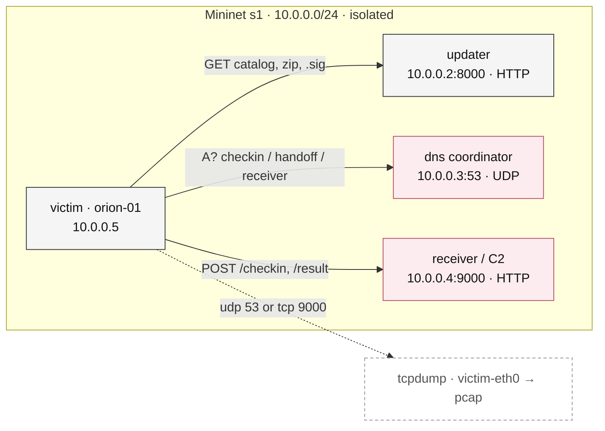
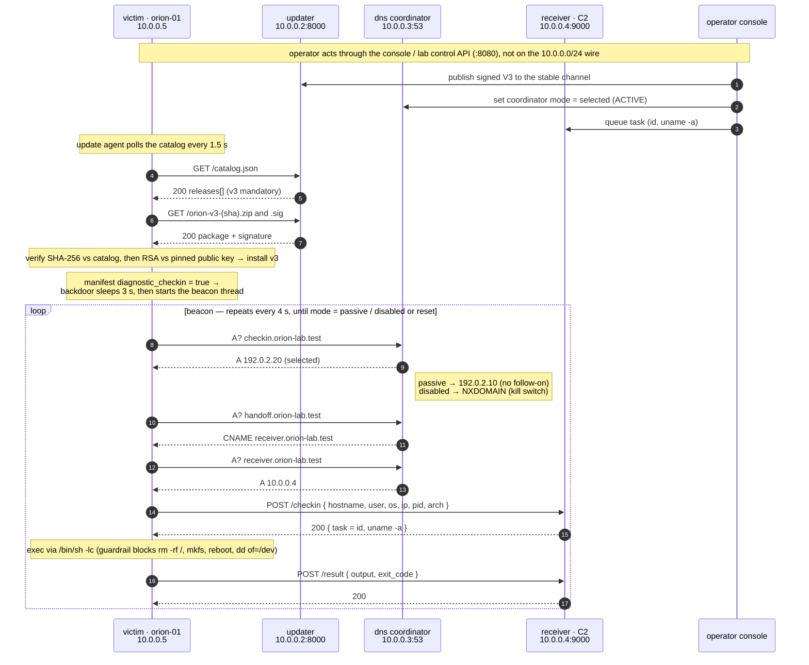

# Task 5 PoC Playbook

This walkthrough follows a signed software release from a supplier pipeline to a managed client, then shows the client's DNS check-in and operator tasking. It is a simulation; the lab installs no real implant.

## Topology

## Sequence Diagram

## Applications

| Application | Address | Role |
| --- | --- | --- |
| **Build & Release** | `http://localhost:8080` | Upload, sign, and publish a build artifact; shows the catalog and pipeline output. |
| **Orion Network Manager** | `http://localhost:8081` | Client update agent, version, and normal update history. |
| **Operator Console** | `http://localhost:8082` | Beacons, typed commands, and the C2 capture. |
| **Presentation Dashboard** | `http://localhost:8083` | Reset button and running services. |

Open each address in its own tab; the apps do not link to each other. Nginx routes ports 8080 to 8083.

## How it works

The lab runs a Mininet network in a Linux container behind a private control API. Addresses live in `lab/config.py`. The supplier writes releases to a shared volume, and the updater serves them to the virtual client. The client polls the stable channel every 1.5 seconds, downloads the ZIP and signature over HTTP inside the isolated network, checks the package SHA-256 against the catalog, verifies an RSA/SHA-256 signature with a pre-provisioned public key, then applies the package. Packages contain only `manifest.json`; the client never executes uploaded code. A fixed routine starts three seconds after a V3 install when `exercise.diagnostic_checkin` is true.

The DNS and HTTP stage follows Mandiant's description of SUNBURST, using fixed local names and preset responses rather than the real DGA or protocol. The private key is read-only in the supplier container; the trust volume holds only the public key. [Mandiant SUNBURST](https://cloud.google.com/blog/topics/threat-intelligence/evasive-attacker-leverages-solarwinds-supply-chain-compromises-with-sunburst-backdoor) [SolarWinds update](https://www.sec.gov/Archives/edgar/data/1739942/000173994221000076/swi-20210507.htm)

## Start and control

Start Docker Desktop on macOS, open `tasks/task05-poc`, and run `docker compose up --build`. On Linux, use Docker Engine with the Compose plugin and the same command.

If a port is taken, set `PIPELINE_PORT=8180 CLIENT_PORT=8181 ATTACKER_PORT=8182 DASHBOARD_PORT=8183` before starting. Run `docker compose down` before rebuilding or to stop.

The Presentation Dashboard has only **Reset lab**. Reset the lab there, and use the client and pipeline apps for update checks, installs, and publishing.

## Walkthrough

1. **Reset.** Click **Reset lab** in the Presentation Dashboard. This resets the channel to V1/V2, installs V2, sets the coordinator to PASSIVE, clears beacons, tasks, and the capture, and restarts the capture.
2. **Set the response mode.** In Operator Console choose **ACTIVE** and click **APPLY**. No beacons exist yet.
3. **Publish the tampered build.** In Build & Release choose `pipeline/sample-v3-malicious.zip`, click **Upload artifact**, then **Sign artifact**. Choose **Stable · mandatory** and click **Publish to stable**. The pipeline validates the manifest, signs it, and publishes it. V3 cannot be republished; reset before uploading another.
4. **Watch delivery.** On the next poll the client downloads the catalog, ZIP, and signature, checks the digest and RSA signature, and installs V3. Update history shows normal events only: found, downloaded, verified, installed.
5. **Watch the beacon.** Three seconds after install the client queries `checkin.orion-lab.test`. In ACTIVE mode the coordinator returns the activation address; the client follows the CNAME handoff and posts its details to the HTTP receiver. The console lists `orion-01`, user, OS, address, process, PID, and architecture. The beacon loop re-checks every four seconds until the coordinator returns NXDOMAIN or the install changes.
6. **Send a command.** Choose **All beacons** or `orion-01` under **Target**, type `id` or `id; uname -a`, and click **SEND COMMAND**. On the next check-in the receiver returns the task, the victim runs it with `/bin/sh -lc`, and the output and exit code appear under **Command results**. A task queued in PASSIVE waits for an ACTIVE check-in.
7. **Compare modes.** PASSIVE returns the passive address with no HTTP follow-on, so new beacons and tasks do not proceed. DISABLED returns NXDOMAIN and stops the current beacon. To run the beacon again, reset the lab and publish V3 again. Reset returns the coordinator to PASSIVE.
8. **Review and reset.** Use the **C2 capture** link for the pcap; it holds only DNS and receiver traffic (updater traffic on port 8000 is excluded). Reset again to clear state.

## Kill-chain mapping

| Phase | Lab event |
| --- | --- |
| Weaponization | Upload the tampered V3 artifact. |
| Delivery | Publish the signed V3 package to stable. |
| Exploitation | Client installs the signed package. |
| Installation | V3 configuration loads and the check-in routine starts. |
| Command and Control | DNS check-in, CNAME handoff, HTTP beacon registration. |
| Actions on Objectives | Operator sends a command; victim returns the output. |

Reconnaissance is not modeled. The follow-on stage is not a general-purpose implant or a recreation of TEARDROP or Cobalt Strike. Commands run in the isolated victim, and a guardrail blocks destructive ones such as `rm -rf /`, `reboot`, `mkfs`, and `dd` to a device.
